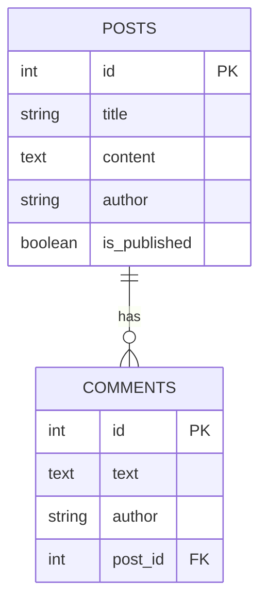

# Название проекта

Тема №4: **Блог**. Сервис, где все могут быть авторами и читателями.

| | |
| --- | --- |
| Главная сущность | Пост (post) |
| Связанная сущность (1:N) | Комментарий (comment) |
| Фишка | ... |
| Стек | Python, FastAPI, SQLite |

## Как запустить (linux)

```bash
# repository install
git clone https://github.com/Axeniter/backend-bakhturin-blog.git
cd backend-bakhturin-blog

# requirements install
python -m venv .venv
source .venv/bin/activate
pip install -r requirements.txt

# server start
uvicorn src.main:app --reload --port 8000
```

Сервис работает на `http://localhost:8000`. Запросы для демонстрации лежат в `requests.http`.

## Эндпоинты

| Метод | Путь | Что делает | Ответ |
| --- | --- | --- | --- |
| GET | `/health` | Проверка, что сервис жив | 200 `{"status":"ok"}` |
| POST | `/api/posts` | Создать | 201 и объект с `id`; 400 при ошибке |
| GET | `/api/posts` | Список | 200 |
| GET | `/api/posts/{id}` | Получить одну запись | 200; 404 |
| PATCH | `/api/posts/{id}` | Изменить | 200; 400; 404 |
| DELETE | `/api/posts/{id}` | Удалить | 204; 404 |

## ER-диаграмма



## Индекс и EXPLAIN

Для поиска по заголовку (`GET /api/posts?q=...`) используется `ILIKE`:

```python
stmt = stmt.where(models.Post.title.ilike(f"%{q}%"))
```

В модели объявлен индекс:

```python
Index("ix_posts_title", "title")
```

Проверка плана запроса:

```sql
EXPLAIN SELECT * FROM posts WHERE title ILIKE '%пост%';
```

Вывод:

```text
                       QUERY PLAN
--------------------------------------------------------
 Seq Scan on posts  (cost=0.00..17.38 rows=1 width=109)
   Filter: ((title)::text ~~* '%пост%'::text)
(2 rows)
```

## Интерфейс

<!-- С лабы 4: скриншот, например  -->
